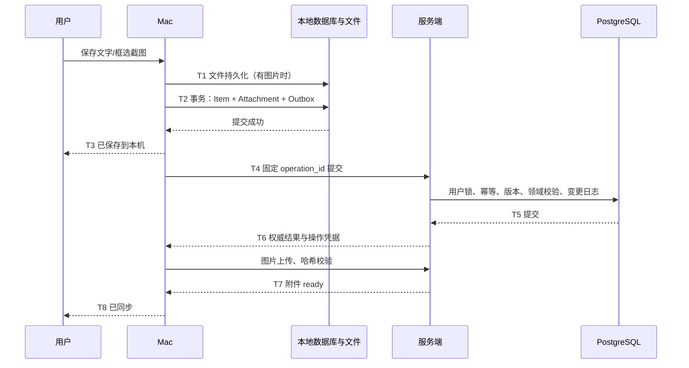

# 同步、提醒与一致性

## 1. 保存与确认的时间点



没有图片时跳过 T1/T7；有图片时 T6 只能称“事项已同步，图片待上传”。本地事务成功才可清输入框；网络失败不影响已保存数据。

## 2. 本地 Outbox

每个操作记录 operation_id、item_id、动作、原始 base_revision、payload、依赖 operation_id、状态、重试时间、最后错误。投影数据、原始操作与必要文件均先落盘；不能只把操作存在内存队列。

同一 Item 的本地连续操作串行发送。尚未得到服务端版本时，用 depends_on 指向前一个本地操作；首次发出前只用前一条**成功确认的自身操作**结果填入 base_revision，并持久化最终请求。第一次发送后冻结该 operation_id 对应的全部请求内容，重试不得重新计算 base_revision。不能在收到远端新版本后无条件把本地旧操作改为最新版本。某条冲突时，该 Item 的后续操作暂停，其他 Item 继续同步。

Outbox 状态：queued → sending → acknowledged；可分支 retry_wait、conflict、needs_auth、invalid。sending 在重启后回到 queued，operation_id 不变。5xx/网络错误按带抖动的 1 秒至 5 分钟退避；达到 10 次后转可见失败并提供手动重试，联网或用户重试可以开始新一轮，仍使用同一 ID。401 不循环重试。

远端拉取写 server_shadow；存在本地未确认变更时，不能用远端实体覆盖界面里的 local_projection。同步引擎依据影子版本和待提交操作重建投影；若不能安全重建，标记冲突并保留两份。

## 3. 服务端事务与游标

```text
认证、范围校验、请求结构校验
BEGIN
  SELECT UserSyncState WHERE owner_id = ? FOR UPDATE
  若 receipt 存在：校验 actor 与 hash，返回已存结果
  读取 Item；检查 owner、deleted_at、base_revision
  应用领域动作，递增受影响实体 revision
  更新事件、提醒规则、具体实例与通知待处理状态
  在当前用户锁内递增 last_seq，插入 change_log
  保存 operation_receipt
COMMIT
提交后发送 SSE 提示（失败不回滚已经成功的业务）
```

同用户所有可同步写入，包括附件 ready、后台提醒状态，都遵守相同用户锁顺序。事务内不访问网络、不编码图片。用户行锁直到 COMMIT 才释放，后一个事务才分配该用户后续 seq，因此不会出现“先分配序号、后提交导致拉取跳过”。不要用 `BIGSERIAL` 的全局分配顺序冒充提交顺序。

cursor 为签名的不透明值，包含 owner、sync_epoch、seq。`GET /sync` 返回 changes、next_cursor、has_more、server_time。单页最多 500 条，按 seq 升序。客户端在同一个 SQLite 事务里应用整页并写 cursor；失败则整页回滚，不能先推进 cursor。

SSE 事件只携带 `changes_available` 和可选高水位，断开后指数退避；应用启动、网络恢复、唤醒和有网络时每 60 秒校验一次增量，不能把 SSE 当唯一可靠通道。SSE 的 Last-Event-ID 不替代持久化 pull cursor。

## 4. 快照、删除和恢复

change_log 与删除完整记录建议保留 90 天，回收站 30 天；ItemIdentity 与幂等最小记录长期保留。低于 min_retained_seq 的 cursor 返回 410。删除进入 change_log，永不依赖客户端猜测“列表没有就是删除”。

快照在短期 REPEATABLE READ 事务中读取已提交 UserSyncState.last_seq 与同一视图下的所有实体，物化成不可变分块，返回 high_watermark 和 epoch；分页读取不能跨多个变化中的实时视图。客户端在独立暂存库下载完整快照，校验完整性后原子替换 server_shadow，再从 high_watermark 增量拉取。快照过程中本地新增记录继续写原 Outbox，替换时保留草稿、本地文件、未确认操作和冲突副本。

恢复服务端备份后必须设置新的 sync_epoch，再接受写请求。客户端首先发现 epoch 改变，暂停旧 Outbox，重拉快照；对恢复点之后的本地数据列出“服务端恢复后的待确认记录”，用户选择重新提交/另存/放弃后才上传。不能仅重置数字游标后重放所有删除、完成和提醒操作。

已物理清理的 Item ID 由 ItemIdentity 阻止复活；离线编辑可导出或以新 ID 另存，但不恢复到同 ID。普通软删除冲突同样显示“服务端已删除”和本地副本。

## 5. 冲突处理

| 冲突 | 自动行为 | 用户选择 |
|---|---|---|
| 两台设备改同一正文 | 服务端拒绝旧版本；保留两份，停该 Item 队列 | 手工合并、使用服务端、用本地覆盖最新、另存副本 |
| 不同字段修改同一版本 | 首版也视为冲突，不自动三方合并 | 同上；可展示字段差异 |
| 完成 vs 稍后提醒 | 旧操作拒绝，不重新生成提醒 | 保持完成；若真要继续必须明确重新打开 |
| 删除 vs 本地追加图片 | 保留本地图片，关联操作进入冲突 | 另存新事项或放弃；不偷偷恢复删除项 |
| 附件上传就绪 vs 正文编辑 | 附件独立版本不改变 Item revision | 正常继续 |

“保留本地”是基于最新 server_revision 的新操作；如果期间又被修改，仍会再次冲突。冲突备份在用户明确解决之前保留。通知权限、通知点击与图片传输状态不通过正文覆盖来解决。

## 6. 提醒的三种对象

Rule 表示安排；Occurrence 表示某次应触发的提醒；Delivery 表示某台设备的登记与交互。三者不能合成一个 `notified=true`。

首版仅一次性明确提醒。创建 rule 时，在同一个事务中立即创建未来 occurrence，不等到到期才生成；否则 Mac 离线前没有机会登记系统通知。服务端工作循环只负责把到时的 scheduled occurrence 标为 due，并保留可恢复工作状态，不发送第二份 Mac 系统通知。

用户修改时间时生成新的 schedule_revision(UUID)，旧 occurrence → superseded；完成、取消、转 memo、删除时旧 occurrence → canceled。同一事项正文修改不变更 schedule_revision。提醒标识：`reminder_id:schedule_revision:occurrence_at`，本地与服务端均使用客户端创建后经服务端校验接受的相同调度 ID。

“等待并通知”在同一动作中建立 purpose=follow_up 的规则；同一 Item 最多一条有效跟进通知，再次设置等待时替换它。收到结果时失效该规则；用户另外建立的 purpose=explicit 提醒独立保留。变更 review_at 本身不会偷偷修改其他提醒。

本地离线创建或改期可先用该稳定 ID 登记；同步被拒绝时撤销本地安排并按服务端校正，冲突内容仍保留。不能把临时通知 ID 和确认后的 ID 同时留在系统里。

## 7. 系统通知校正

Mac NotificationReconciler 根据本地权威版本加有效离线投影计算目标集合，与系统 pending requests 作差集；删除旧 ID，补充缺失 ID，更新有必要变化的可见文案。完成操作本地提交后立即取消 pending 和已投递列表中的本事项通知；服务端确认后再校正一次。

登记回调成功记录 accepted，不记录 seen。打开通知记录 opened；完成、稍后对应领域动作；关闭通知最多记录 dismissed（仅在系统回调可观测时），不假装总能观测。应用退出后已登记通知由系统管理，具体呈现仍受系统权限、专注模式和设备运行状态影响。[UserNotifications](https://developer.apple.com/documentation/usernotifications/scheduling-a-notification-locally-from-your-app)

首版尝试登记所有已知有效的未来一次性提醒；不设置隐藏的每日条数上限。系统拒绝或达到实际容量限制时明确显示“有 N 条尚未登记”，保留列表并重试；不能宣称所有远期提醒已登记。Phase 0 实测容量与行为，不能把 iOS 的经验数量直接当作 macOS 常量。

迟到规则：唤醒/重启发现已过期且未处理的提醒，先进入需要关注；若有多条，最多生成一条遗漏汇总通知，不逐条补发历史弹窗。未来明确提醒仍照常登记。“稍后提醒”把该次提醒移到新时刻，但截止逾期、计划到期、复查到期仍各自有效。

用户启用每天一次的合并回顾通知后，Mac 按账号 home_timezone 登记单独的每日汇总请求，文案不固定承诺候选数量。该请求不代替 Item 提醒；偏好改变时撤销旧请求。设备离线或应用退出时可能出现已无候选的通用回顾提示，重新运行后校正；真实候选始终以打开时的列表为准。

## 8. 时间与关注计算

```text
if deleted or kind == memo or task_state in [completed, canceled]: []
reasons = []
if task and planned_for <= item_local_date: + planned
if task and due_date == item_local_date: + due_today
if task and due_date < item_local_date: + overdue
if task and due_at <= now: + overdue
if task and due_at is later on item_local_date: + due_today
if task and review_at <= now: + follow_up
if valid occurrence is due and not superseded/canceled: + reminder
return unique reasons
```

无日期回顾单独计算，不把整份 backlog 加到菜单栏数字。服务器与 Mac 共用一份输入/输出 JSON 测试样本验证规则。系统日期改变、时区改变、午夜、唤醒时重新计算；不更新 last_progress_at。

未来 recurring 需要单独规则类型和版本，区分日历重复与完成后间隔，处理 DST；首版不暗中用复制 Item 代替。即使一次性提醒，用户选不存在的当地时刻也需明确提示修正，重复时刻显示偏移供确认。

## 9. 故障边界

| 故障 | 保证与限制 |
|---|---|
| 网络断开 | 已保存文字/图片与 Outbox 留在本机；已有系统安排继续由系统管理 |
| 服务器提交后响应丢失 | 同 ID 重试，返回 receipt，不重复创建 |
| 服务器重启 | 规则与未来实例在数据库；工作循环恢复 |
| Mac 退出 | 无后续同步；已知安排仍可能由系统呈现，需实机验证 |
| Mac 关机/睡眠 | 不保证当时展示；恢复后补充需要关注与遗漏汇总 |
| 另一设备完成、本机离线 | 旧提醒可能出现；联网后撤销；点击旧通知仍校验状态 |
| 本地磁盘损坏且未同步 | 无法保证恢复；只有已上传/已备份的数据可按恢复点恢复 |

目标是可恢复保存、冲突不丢数据、提醒状态可解释；不承诺离线多端下恰好通知一次。
