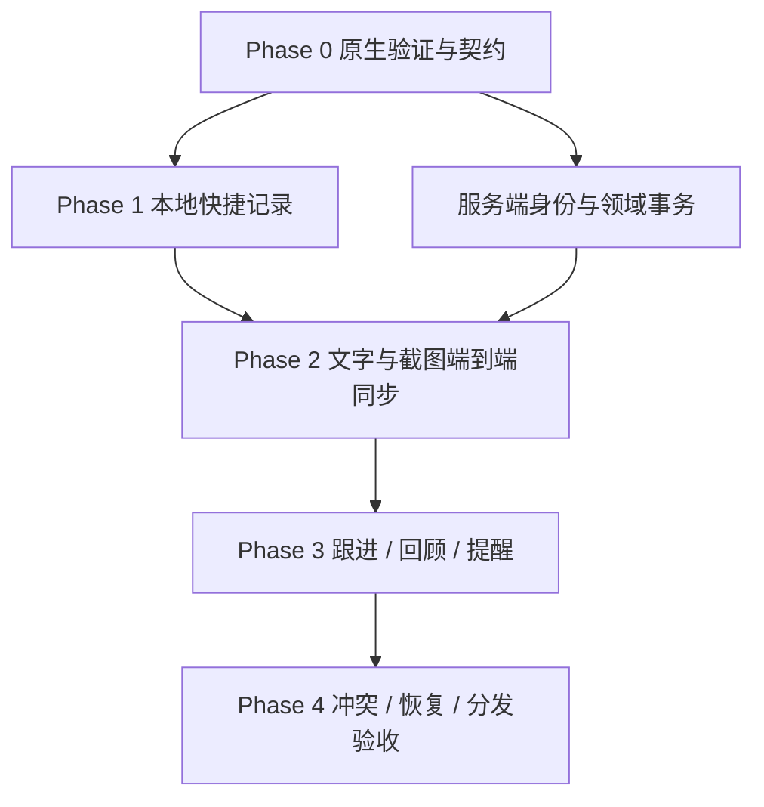

# 实施计划

## 1. 估算口径与依赖

下表按一名熟悉 Go/Swift 的全职工程师顺序实施，建议初始预算为 **46–60 人日**，包含实现、真实 Mac 测试、故障验证与修复缓冲。不是交付承诺；Phase 0 后按实际权限、工具链和分发结果重估。若两名工程师分别负责 Mac 和 Go，可在契约固定后并行实现，但数据库/同步/附件必须共同集成验收。

用户无需批准普通技术实现细节才能开始。账号部署地址、签名团队与真实测试 Mac 在实施时需要实值；本次没有这些实值，不虚构已部署环境。

## 2. Phase 0：先验证不能靠文档保证的部分（4–6 人日）

当前无旧代码，没有可修复的历史 bug；这里的前置工作是验证与建工程，不冒称“修复现有模块”。建议单独交付基础工程 PR，若尚未建立远端则仅作本地版本提交。

| 建议工作日 | 任务 | 未来文件 | 退出条件 |
|---|---|---|---|
| D1 | 建 monorepo、Swift/Go 工程、锁工具版本与CI | apps/macos/、services/api/go.mod、infra/ | 最小菜单栏包能签名运行，API 健康检查可跑 |
| D2 | 验证热键、中文输入、焦点和系统版本 | apps/macos/Sources/App/、Capture/ | AC-CAP-003、AC-MAC-001 有实机记录 |
| D3 | 截图权限、区域映射、图片落盘试验 | ScreenshotService.swift、AttachmentStore.swift | 真机截图不含自身遮罩；拒权可降级 |
| D4 | 通知登记、取消、退出/唤醒和容量验证 | NotificationReconciler.swift | 明确系统实际边界，更新方案 |
| D5–D6 预留 | 契约校对、性能基线、分发问题修正 | contracts/openapi.json、fixtures/ | 决定是否保留 macOS 14 最低版本 |

## 3. Phase 1：本地快捷记录（6–8 人日）

先做能每天使用的本地文字与截图：Database/迁移 → DraftStore → CaptureCoordinator → ClipboardImporter/拖放 → 图片恢复扫描 → 状态收条与撤销。TDD 优先本地事务、IME 提交判定和崩溃恢复；窗口实际行为用实机补充。

建议 D7–D8 数据库/草稿，D9–D10 文字/截图统一提交，D11 剪贴板与拖放，D12–D14 预留边界修复。阶段出口：AC-CAP-001 至 AC-CAP-007 通过；断网使用不依赖服务端。不要先花几天做标签、复杂设置或视觉动效。

## 4. Phase 2：完整同步路径（10–13 人日）

身份授权 → Item 动作/事件/幂等 → per-owner change_log → Outbox 与影子版本 → 图片上传与校验 → 快照/冲突最小交互。约 D15–D17 服务端事务，D18–D20 客户端同步，D21–D23 附件，D24–D27 冲突/快照与集成预留。

出口：同一张截图可以在清空测试客户端后从服务端还原；已确认文字与未上传图片分别显示；响应丢失不重复创建；两个设备并发不丢正文。对应 AC-SYNC-001 至 AC-SYNC-004、AC-ATT-001/002、AC-AUTH-001。

## 5. Phase 3：防遗漏与恢复上下文（8–10 人日）

D28–D29 状态/等待/进展；D30–D31 无日期回顾与搜索；D32–D34 提醒规则、未来实例、系统校正；D35–D37 历史/回收站/分组/设置与预留。先通过共享规则样本，再分别测试服务端和 Mac。

出口：从快捷记录到等待、复查、收到结果、继续、完成有完整路径；关闭通知不能结束事项；纯截图能再次进入待整理回顾。对应 AC-DOM-001/002/003、AC-SEARCH-001、AC-NOT-001 至 AC-NOT-004。

## 6. Phase 4：恢复、故障与发布（18–23 人日，含修复缓冲）

日程按前面阶段上限顺排：D38–D40 导出和一致备份，D41–D43 恢复与 epoch，D44–D47 故障注入，D48–D50 性能与存储边界，D51–D55 签名分发、升级和真实权限回归，D56–D60 作为修复缓冲。若前置阶段提前完成，本阶段相应前移；全项目预算仍为 46–60 人日。缓冲按失败项使用，不能预先记为完成。

发布门槛：所有 P0、P1 验收完成；一轮真实备份恢复；两个模拟设备加一台真实 Mac 集成；签名安装包验证；没有已知会丢数据的冲突/崩溃问题。截图与通知实测失败时继续修复，不能把浏览器示意当成替代品。

## 7. 测试先行与完成定义

先为状态、幂等、游标提交次序、附件崩溃、完成/稍后冲突写失败测试；最小实现通过后再接 UI。普通文案和可逆样式不堆机械测试。每个任务必须引用 AC；完成时更新[任务清单](05_task_checklist.md)、保存测试证据并记录实际耗时。

若平台实际行为与设计不同，先更新受影响的产品文案、架构规则和验收，再实现修订方案；不能只在代码里悄悄删掉失败路径。第二批的 OCR、分享扩展、语音附件、重复事项与 Agent 不挤占首版恢复验证。
