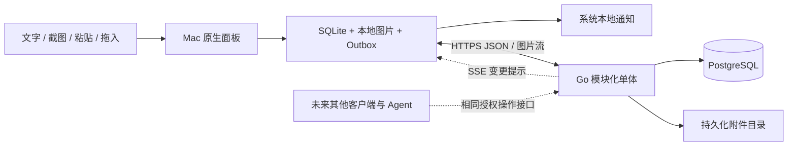

# AM-001：个人备忘录产品与架构设计

| 属性 | 内容 |
|---|---|
| 日期 | 2026-10-13 |
| 状态 | 设计交付，可进入技术验证与实现；不是已实现的产品 |
| 产品暂名 | AIMemorandum |
| 核心目标 | 未完成事项不被遗漏；随时记下，回来能继续 |
| 第一优先级 | 记录方便、操作少、本机保存可靠 |
| 首发 | macOS 原生菜单栏应用；统一 Go 服务端；本地 SQLite 与 PostgreSQL 同步 |

## 1. 建议采用的产品方案

入口只保留一个快速记录面板，日常以快捷键为主。文字、截图、剪贴板文字或图片、拖入图片和链接，最终进入同一份事项列表。**截图属于首版必做功能**，不要求输入标题、选择项目、填写日期或再次点击保存。

常用路径：

| 记录方式 | 熟练使用时的路径 | 必须作出的额外决定 |
|---|---|---|
| 文字 | 快捷键 → 输入 → Enter | 无 |
| 直接待办 | 快捷键 → 输入 → ⌘Enter | 无 |
| 区域截图 | 截图快捷键 → 框选并松手 → 自动保存 | 选择截图区域 |
| 剪贴板速存 | 已复制内容 → 速存快捷键 → 自动保存 | 无 |
| 图片拖入 | 拖到打开面板的“放开即保存”区域 → 保存 | 无 |
| 输入框粘贴 | 快捷键 → ⌘V → Enter | 无，可加一句说明 |

首次系统授权不计入日常步骤，但必须单独测试。图片保存后进入待整理，按回顾规则再次出现；它不能变成被遗忘的图片仓库。等待、下一步、复查时间仍然是事项的主要功能。

## 2. 当前项目的实际情况

2026-10-13 检查了 `/Users/zhengtianyou/Documents/Projects/AIMemorandum`：目录为空；`git status` 与 `git log` 返回“not a git repository”；未发现源码、数据库迁移、历史设计或项目内 AGENTS.md。用户在会话中给出的中文与保真要求适用于本交付。

### 已建内容

| 内容 | 核实结果 | 证据 |
|---|---|---|
| 工作目录 | 已存在 | 初始目录列表只有 `.`、`..` |
| 可验证的产品功能 | 无 | 未发现源码，不能声称任何功能或性能已实现 |

### 尚未建设

| 范围 | 现状 |
|---|---|
| Mac 客户端、服务端、部署 | 均未实现 |
| 同步、截图、通知、备份恢复 | 均未实现、未做真实环境验证 |
| 本目录中的契约与测试示例 | 设计材料；不能作为运行通过的证据 |

### 与原方案的差异

| 原方案 | 本设计 | 原因与影响 |
|---|---|---|
| 图片附件后置 | PNG/JPEG 截图和图片附件纳入首版 | 用户明确要求多种快捷记录方式；必须增加文件落盘、上传、校验、下载与备份 |
| OCR 后置 | 继续后置，作为可选的本机检索增强 | 截图保存不依赖识别；首版不引入模型调用或 AI 判断 |
| 未确定系统版本 | 暂定 macOS 14+，分发采用签名与公证安装包 | 优先使用现代截图 API；最低版本、签名与权限行为须在 Phase 0 实机验证 |
| 假定有现有工程可扩展 | 新项目设计 | 没有旧接口迁移，也没有可复用实现的证据 |

## 3. 设计原则与范围

| 原则 | 本设计落实位置 |
|---|---|
| 先保存，后整理 | 文字无需分类；截图、速存和拖入自动保存；草稿落盘 |
| 保存与同步分开 | 本地事务先完成；附件未上传也明确显示待同步 |
| 未结束事项有再出现方式 | 明确时间、等待复查、无日期回顾；删除、取消、完成有明确语义 |
| 少操作不等于自动猜意图 | 不解析自然语言日期、不自动完成、不读取未主动提供的内容 |
| 通知不能代替记录 | 关闭通知不完成事项；通知失败仍在关注列表 |
| 不虚构已有能力 | 所有工程指标为目标；实机与故障测试列为发布门槛 |

首版包括文字与基础 Markdown、链接、检查清单、PNG/JPEG、截图、快捷记录、状态、进展、等待、回顾、搜索、回收站、撤销、离线、冲突、同步、授权与导出备份。首版不做协作、复杂项目、AI、重复任务、音视频附件、OCR、全剪贴板采集、窗口监控。语音输入可使用系统听写，在支持的输入控件中输入文字；本产品不保存录音、不提供自建转写服务。

## 4. 架构概览

| 子系统 | 建议未来代码目录 | 主要职责 |
|---|---|---|
| Mac | `apps/macos/` | 快速记录、窗口、草稿、本地存储、同步、通知 |
| 服务端 | `services/api/` | 认证、领域操作、附件、增量同步、提醒状态 |
| 契约 | `contracts/` | OpenAPI、错误码、跨语言规则测试样本 |
| 部署 | `infra/` | Compose、TLS、备份、恢复、运行检查 |

以上是未来目录，不代表当前存在。当前交付只写入本方案目录。

## 5. 文档导航

| 文档 | 内容 |
|---|---|
| [产品设计](01_product/01_product_design.md) | 页面、状态、回顾、通知、首版范围 |
| [快捷记录与交互](01_product/02_capture_and_interaction.md) | 文字、截图、粘贴、拖入、步数、异常与权限 |
| [界面示意](01_product/03_wireframes.html) | 可切换的菜单栏面板、截图收条、等待与冲突示意 |
| [截图记录预览](01_product/03_capture_preview.jpg) | 浏览器中检查后的截图收条示意 |
| [领域模型与接口](00_shared/01_domain_and_api.md) | 字段、动作、约束、授权、错误语义 |
| [同步与提醒](00_shared/02_sync_and_reminders.md) | 离线、冲突、游标、删除、通知校正 |
| [性能与验收](00_shared/03_performance_and_acceptance.md) | Given/When/Then 场景和实测方法 |
| [实施计划](00_shared/04_implementation_plan.md) | Phase 0、依赖、建议人日与发布门槛 |
| [开发任务清单](00_shared/05_task_checklist.md) | 任务 ID、未来文件路径、验收关联 |
| [测试设计](00_shared/06_test_design.md) | Go/Swift 测试示例、故障注入、实机测试 |
| [Mac 架构](macos/01_client_architecture.md) | AppKit/SwiftUI、截图坐标、存储、焦点与搜索 |
| [服务端架构](server/01_server_architecture.md) | 模块、表结构、事务、附件、提醒工作表 |
| [安全与运维](server/02_security_operations.md) | 单用户设备授权、备份恢复、导出、日志与部署 |
| [OpenAPI 草案](contracts/openapi.json) | 可被工具读取的接口、请求和响应结构 |
| [决策与依据](decisions/01_decisions_and_sources.md) | 技术依据、假设、未验证事项、演进 |
| [交付校验](VALIDATION.md) | 本次实际检查的范围与结果 |
| [接口生成脚本](contracts/build_openapi.py) / [文档校验脚本](validate_design.py) | 用标准库重新生成接口草案、检查文件结构 |

## 6. 实施顺序与主要风险

先做真实 Mac 上的快捷键、截图权限和通知验证，再打通“记录 → 本地持久化 → 同步 → 提醒 → 完成撤销”；之后加入等待和恢复上下文，最后集中验证故障恢复。截图是第一条完整路径的一部分，不能只做文字后把截图一直推后。

| 风险 | 等级 | 处理 |
|---|---|---|
| 图片记录看似保存，文件却丢失 | CRITICAL | 文件先持久化、事务引用、崩溃恢复；未上传提示；备份包含图片 |
| 并发或快照覆盖离线改动 | CRITICAL | 原始操作和冲突副本保留；快照不清除 Outbox |
| 完成后旧通知出现 | HIGH | 同事务失效规则；本地调度差集校正；承认离线设备边界 |
| 截图授权或系统交互比预期多 | HIGH | Phase 0 实机通过；保留系统截图后粘贴的可用路径，不宣称零授权 |
| 快捷键冲突、中文输入误提交 | HIGH | 可改键、marked text 检查、真实输入法测试 |
| 首版因附件而超范围 | MEDIUM | 只支持 PNG/JPEG、有限大小；不做图像编辑器、OCR、视频 |

产品、架构、技术、演进四个层次分别由产品文档、客户端/服务端设计、共享协议与契约、决策与实施计划覆盖。无需在此阶段接入现有 Agent；其代码和实际接口尚未检查，本方案只定义将来的授权边界。
